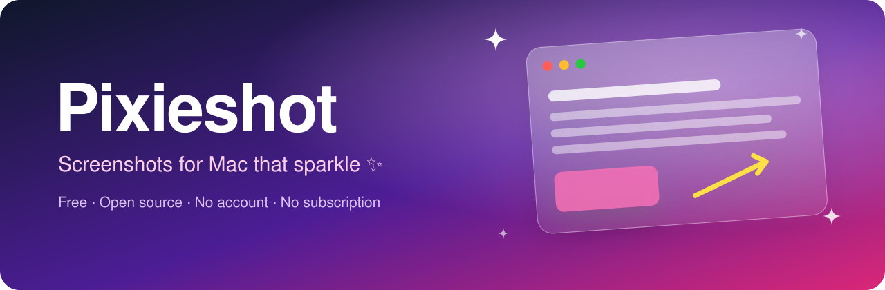

<div align="center">



# Pixieshot ✨

**The free, open-source screenshot tool for Mac that makes every screenshot look ready to post.**

Capture, annotate, beautify, copy text, scroll-capture and record your screen.
No account, no subscription, no watermark. A cosy little free alternative to CleanShot X and Xnapper.

[](LICENSE)
[](#-install)
[](https://www.qt.io/)
[](https://github.com/flameshot-org/flameshot)
[](https://github.com/masharratt/pixieshot/stargazers)

[Features](#-features) · [Install](#-install) · [Shortcuts](#-keyboard-shortcuts) · [Build](#-build-from-source) · [Credits](#-credits-and-license)

</div>

---

## 🌸 Why Pixieshot?

Most screenshots look like… screenshots. Pixieshot wraps yours in a soft gradient, rounds the corners, floats it on a shadow and sizes it for wherever you're posting, in one click. Then it goes further: copy text out of any image, capture a whole scrolling web page, record your screen with click ripples and trim the clip before you share it.

Everything runs on your Mac. Nothing is uploaded unless you ask.

## ✨ Features

### 🎀 Beautify, in one click
- **Gradient or solid backgrounds** with adjustable padding
- **Rounded corners, drop shadow and border**
- **Size presets:** square 1:1, 16:9, 9:16 stories, 4:5 feed and 4:3
- **Auto-balance:** evens out lopsided margins so your content sits perfectly centred
- Use the **Beautify** button for one capture, or switch on **Beautify every capture**

### 🔤 Copy text from anything
- Select an area and click **Copy Text**: its text lands on your clipboard
- Reads **QR codes** too
- Uses Apple's on-device text recognition, so nothing leaves your Mac

### 📜 Scrolling capture
- Capture a whole web page, chat or document as **one tall image**
- Scroll by hand, or let **auto-scroll** do it for you
- Sticky headers and footers are detected so they don't repeat

### 🎬 Screen recording
- Record to **MP4 or GIF**
- **Click ripples** show viewers exactly where you clicked
- **Trim** the start and end, and **Beautify** the video with the same backgrounds as your screenshots

### ✏️ Annotate
- Arrows, lines, pen, highlighter, boxes, circles, numbered steps and text
- Pixelate or blur private details
- **Re-editable projects:** reopen a capture from history and your arrows and labels are still movable

### 🧚 Little conveniences
- **Capture timer** (up to 10 seconds) to catch menus and hover states
- **Pin** a screenshot so it floats above your windows
- **Floating thumbnail** after each capture: click to reopen, drag to drop into any app
- **Capture history**, **workflows** per hotkey (save, copy, beautify, open editor) and an optional uploader

## 💖 How it compares

| | Pixieshot | CleanShot X | Xnapper | Shottr |
|---|:---:|:---:|:---:|:---:|
| Price | **Free** | Paid | Paid | Free tier |
| Open source | ✅ | ❌ | ❌ | ❌ |
| Gradient backgrounds and size presets | ✅ | ✅ | ✅ | ➖ |
| Copy text (OCR) | ✅ | ✅ | ✅ | ✅ |
| Scrolling capture | ✅ | ✅ | ❌ | ✅ |
| MP4 and GIF recording with trim | ✅ | ✅ | ❌ | ❌ |
| Beautified screen recordings | ✅ | ✅ | ❌ | ❌ |
| Re-editable annotations | ✅ | ✅ | ❌ | ❌ |

<sub>Based on public feature pages as of October 2026. Competitors change often, so check their sites for the latest.</sub>

## 📦 Install

Pixieshot is built for **macOS 15 Sequoia or newer** on Apple Silicon and Intel.

There are no prebuilt downloads yet, so for now build it from source (below). It takes about five minutes.

The first time you capture, macOS asks for **Screen Recording** permission. Auto-scroll in scrolling capture also asks for **Accessibility** permission. You can say no and scroll by hand instead.

## ⌨️ Keyboard shortcuts

Inside the capture screen:

| Key | Action |
|---|---|
| <kbd>A</kbd> | Arrow |
| <kbd>P</kbd> | Pen |
| <kbd>D</kbd> | Line |
| <kbd>R</kbd> | Rectangle |
| <kbd>C</kbd> | Circle |
| <kbd>M</kbd> | Highlighter |
| <kbd>T</kbd> | Text |
| <kbd>B</kbd> | Pixelate |
| <kbd>⌘</kbd> <kbd>C</kbd> | Copy |
| <kbd>⌘</kbd> <kbd>S</kbd> | Save |
| <kbd>⌘</kbd> <kbd>Z</kbd> | Undo |
| <kbd>Esc</kbd> | Cancel |

Global hotkeys (capture, record GIF, record MP4, scrolling capture) are set in **Settings → Shortcuts**.

## 🛠 Build from source

You'll need [Homebrew](https://brew.sh), Qt 6 and CMake:

```bash
brew install qt cmake ninja
git clone https://github.com/masharratt/pixieshot.git
cd pixieshot
cmake -S . -B build -G Ninja -DQt6_DIR="$(brew --prefix qt6)/lib/cmake/Qt6"
cmake --build build
ctest --test-dir build        # optional: run the tests
open build/src/flameshot.app
```

To keep macOS from asking for Screen Recording permission after every rebuild, sign with a local self-signed certificate and pass `-DCODE_SIGN_IDENTITY="<certificate name>"` to the first `cmake` command.

> The app bundle is still called `flameshot.app` inside the build folder while the rename settles in.

## 🗺 What's next

Ideas on the list: Liquid Glass frames, animated backgrounds for stills, colour palettes picked from your screenshot, spotlight and magnifier tools, and auto-hiding private info. See [readme/BACKLOG.md](readme/BACKLOG.md).

Got an idea or found a bug? [Open an issue](https://github.com/masharratt/pixieshot/issues). 💌

## 🙏 Credits and license

Pixieshot is a fork of the wonderful [**Flameshot**](https://github.com/flameshot-org/flameshot) by its many contributors. All the core capture and annotation magic comes from them. Pixieshot adds the Mac-focused features above.

- The main code is licensed under [GPLv3+](LICENSE). You're free to use, change and share it, including commercially, as long as shared copies stay under the same license with source available.
- The Flameshot logo is licensed under the [Free Art License v1.3](data/img/app/flameshotLogoLicense.txt).
- The button icons are licensed under Apache License 2.0. See: https://github.com/google/material-design-icons
- The code at capture/capturewidget.cpp is based on https://github.com/ckaiser/Lightscreen/blob/master/dialogs/areadialog.cpp (GPLv2)
- The code at capture/capturewidget.h is based on https://github.com/ckaiser/Lightscreen/blob/master/dialogs/areadialog.h (GPLv2)
- A few lines of code come from KSnapshot regiongrabber.cpp revision `796531` (LGPL)
- Qt-Color-Widgets taken and modified from https://github.com/mbasaglia/Qt-Color-Widgets (see their license and exceptions in the project) (LGPL/GPL)

**Privacy:** Pixieshot never sends information over the network unless you ask it to, for example by using the uploader.

<div align="center">
<sub>Made with ✨ on a Mac · If Pixieshot made your screenshot prettier, a ⭐ helps others find it</sub>
</div>
